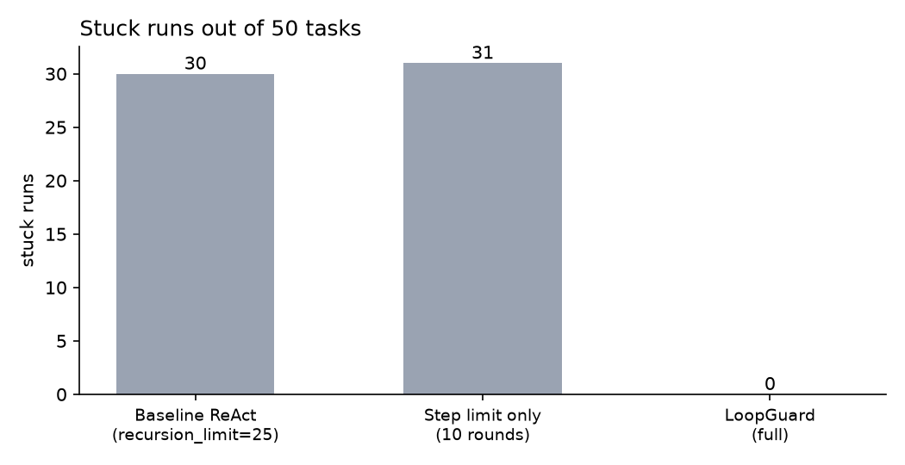
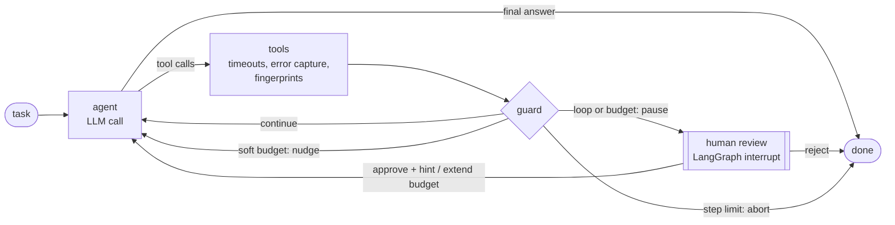

# LoopGuard Agent

Guardrails for tool-calling LLM agents: **loop detection, step limits, token and cost budgets,
and human approval** when an agent starts repeating itself. Built on LangGraph, served with
FastAPI, observable with Prometheus and Grafana, deployable with Docker and Kubernetes.

**Result on a 50-task benchmark:** stuck rate fell from **60% (30/50)** for a plain LangGraph
ReAct agent to **0% (0/50)** with LoopGuard, while total tokens fell by 38%. Loops are caught at a
median of **3 tool calls** instead of running to the recursion limit.



## The problem

Agents get stuck. A tool returns 503 and the model retries the same call. A job status says
RUNNING and the model polls forever. A search finds nothing and the model rephrases it again and
again. Each extra step resends the whole conversation, so cost grows faster than the step count.

Framework limits do not help much. In LangGraph 1.2 the default `recursion_limit` is 10,007
supersteps, so the default will not stop a loop in practice. A hard step cap stops the spend, but
it cannot tell a loop from a long legitimate task, and it fails the run instead of recovering it.

## How it works



After every tool round the **guard** node evaluates the run's checkpointed history:

| Rule | Fires when | Default | Action |
|---|---|---|---|
| `exact_repeat` | same tool, same args, same normalised output N times | N = 3 | pause |
| `cycle` | input sequence ends in a repeating pattern (A B A B A B) | 3 repeats | pause |
| `stagnation` | same tool returns the same output for N different inputs | N = 3 | pause |
| `tool_overuse` | one tool called more than K times in the window | K = 8 | pause |
| token / cost budget | the next prompt would exceed the budget (preflight) | 20k tokens, $0.25 | pause |
| soft budget | 80% of budget used | 0.8 | nudge the model |
| step limit | tool rounds reach the cap | 20 | abort |

**Normalisation** makes repeats visible: UUIDs, ISO timestamps and long hex ids are masked, and
free-text arguments echoed back in the output ("No results for 'pet insurance'") are replaced by a
placeholder. Identifiers such as `job-1004` are not masked, so checking three different jobs is
not mistaken for a loop.

**Human in the loop** uses LangGraph `interrupt()` with a checkpointer. A paused run is stored in
PostgreSQL; any replica can resume it. Resume is a compare-and-set in the database, so two
reviewers cannot resume the same run twice. On approval the guard starts a fresh detection window
and tells the model what it was repeating.

## Benchmark

`loopguard eval` runs 50 tasks: 20 healthy, 30 loop traps (6 each of retry after 503, a job that
never finishes, empty search, circular records, runaway pagination). It uses a seeded, scripted
model so it runs offline in CI and gives the same numbers every time; pass `--provider openai`
to run the same tasks against a real model. Reviews are answered by a fixed policy: one second
chance with a hint, then stop.

| Variant | Stuck | Passed | Tokens | Reviews | Loop false positives |
|---|---|---|---|---|---|
| Baseline ReAct, recursion_limit=25 | 30/50 (60%) | 20/50 | 492,574 | 0 | 0 |
| Step limit only, 10 rounds | 31/50 (62%) | 19/50 | 376,291 | 0 | 0 |
| **LoopGuard** | **0/50 (0%)** | **39/50** | **304,169** | 44 | 1 |

Of the 30 traps, 19 ended with an honest answer after one hint ("the weather service is
unavailable") and 11 were stopped by the reviewer. Threshold sweep: N = 2 catches loops one call
earlier but also flags legitimate polling (3 false positives against 1 at N = 3); N = 4 costs 14%
more tokens. The one false positive at N = 3 is a healthy task that looks up 10 orders, over the
per-tool cap of 8; the reviewer approves it and it completes. Full
tables: [reports/BENCHMARK.md](reports/BENCHMARK.md).

## Quick start

```bash
make install            # uv venv + editable install with dev extras
make test               # 40 tests, ruff, mypy in CI
make eval               # 50-task benchmark -> reports/
loopguard run "What's the weather in Chennai right now?"   # interactive review in the terminal
make serve              # API + review console at http://localhost:8000
```

Full stack (API, PostgreSQL, Prometheus, Grafana):

```bash
cp .env.example .env    # set LOOPGUARD_LLM_PROVIDER=openai and OPENAI_API_KEY for a real model
docker compose up --build
```

## API

| Method | Path | Purpose |
|---|---|---|
| POST | `/v1/runs` | start a run; body `{"task": "...", "guard": {"max_steps": 10}}` |
| GET | `/v1/runs?status=paused` | review queue |
| GET | `/v1/runs/{id}` | detail: tool calls, guard events, usage, pending review |
| POST | `/v1/runs/{id}/decision` | `{"action": "approve" \| "reject" \| "extend_budget"}` |
| GET | `/healthz`, `/readyz`, `/metrics` | probes and Prometheus |
| GET | `/` | review console |

```bash
curl -s -X POST localhost:8000/v1/runs -H 'content-type: application/json' \
  -d '{"task": "Is the nightly export job-2001 finished?"}'
# -> {"status": "paused", "pending": {"kind": "loop", "detector": "exact_repeat", ...}}
curl -s -X POST localhost:8000/v1/runs/<id>/decision -H 'content-type: application/json' \
  -d '{"action": "approve", "note": "Report the status instead of polling."}'
```

Set `LOOPGUARD_API_KEY` to require an `X-API-Key` header on `/v1`.

## Observability

Prometheus metrics include `loopguard_stuck_runs_total`, `loopguard_guard_triggers_total{detector}`,
`loopguard_hitl_pauses_total`, `loopguard_hitl_decisions_total`, `loopguard_llm_tokens_total`,
`loopguard_llm_cost_usd_total`, `loopguard_pending_reviews` and step and token histograms.
`deploy/prometheus/alerts.yml` records the stuck rate and alerts above 5%. The Grafana dashboard
is provisioned automatically. Set `LANGSMITH_TRACING=true` to trace every graph step in LangSmith.

## Configuration

All settings are environment variables with the `LOOPGUARD_` prefix; nested guard settings use
a double underscore, for example `LOOPGUARD_GUARD__MAX_STEPS=20`. See `.env.example`. Per-run
overrides go in the `guard` field of `POST /v1/runs`.

## Project layout

```
src/loopguard/
  guards/      fingerprint.py, detectors.py, budget.py, policy.py   pure, unit-tested logic
  agent/       graph.py (LangGraph), tools.py, llm.py, fake_llm.py, runner.py
  api/         FastAPI app, schemas, static review console
  eval/        50 tasks, harness, report writer
  service.py   run lifecycle, store.py (SQLAlchemy), metrics.py (Prometheus)
deploy/        k8s (Kustomize), prometheus, grafana
tests/         unit, graph, API, benchmark, PostgreSQL integration
```

## Limitations

- Benchmark numbers come from a scripted model and a scripted reviewer. They show the guard
  works as designed; a live model will loop in different places. Run `loopguard eval --provider
  openai --model <name>` to measure yours.
- Runaway pagination (new input and new output every call) is only caught by the per-tool cap.
- Token counts in the offline benchmark use a 4-characters-per-token estimate; real runs use the
  provider's reported usage.
